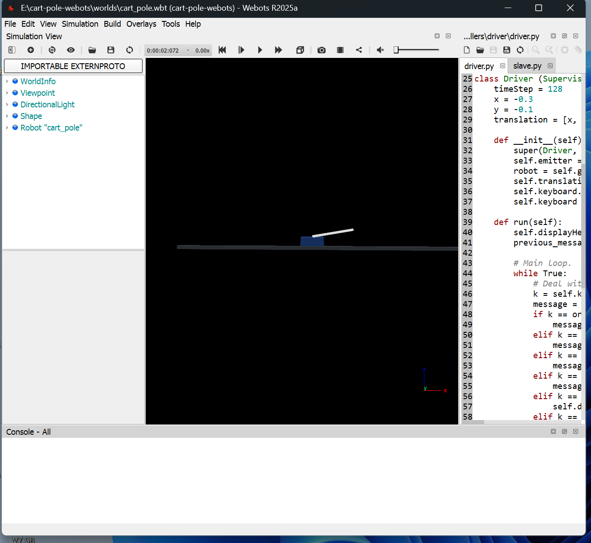

# Webots Cart-Pole

Webots R2025a 的一阶倒立摆（cart-pole）仿真项目。

A1 阶段完成**被动开环模型**：小车只能沿世界 X 轴直线滑动，摆杆从 `+0.08 rad` 的初始倾角开始在重力作用下绕 Y 轴自由倒下。当前世界不包含电机或控制器，控制器字段为 `<none>`。

## 当前状态

- A0 环境验收：通过（Webots R2025a，Python 3.14.7 64-bit）
- A1 被动模型：通过
- A2 Python 控制器：待开始

## 模型参数

| 符号 | 含义 | 值 |
|---|---|---:|
| `M` | 小车质量 | `1.00 kg` |
| `m` | 摆杆质量 | `0.24 kg` |
| `L` | 摆杆长度 | `0.50 m` |
| `l` | 铰点到摆杆质心距离 | `0.25 m` |
| `J_y` | 摆杆绕质心、平行于铰轴的转动惯量 | `0.00501 kg·m²` |
| — | 小车行程 | `-1.50 ～ +1.50 m` |
| `θ₀` | 摆杆初始倾角 | `+0.08 rad` |
| — | 仿真步长 | `8 ms` |

`J_y` 由均匀刚性杆 `m(L² + w²)/12` 计算，其中截面宽度 `w = 0.025 m`，约为 `0.00501 kg·m²`。

## 坐标与符号约定

- 世界坐标系：`ENU`，`+X` 向右，`+Y` 为铰轴方向，`+Z` 向上。
- 直立为 `θ = 0 rad`；杆顶向 `+X` 倾斜为正。
- 后续控制输入定义为小车沿 `+X` 的力 `F`，单位 `N`。
- `cart_position` 位置传感器单位为米；`pole_angle` 位置传感器单位为弧度。

## 文件结构

```text
cart-pole-webots/
  worlds/cart_pole.wbt          # A1 被动 cart-pole 世界
  docs/
    a1-initial.png              # 初始姿态
    a1-fall.png                 # 摆杆倒下
    a1-verification.txt         # A1 数值摘要
    a1-probe-run1.csv           # 8 ms 采样，第 1 次
    a1-probe-run2.csv           # 8 ms 采样，第 2 次（与第 1 次一致）
    A1-acceptance.md            # A1 验收记录
  README.md
```

## 运行方法

1. 使用 Webots R2025a，选择 `File → Open World`，打开 `worlds/cart_pole.wbt`。
2. 模型没有控制器和电机，`Robot.controller` 为 `<none>`，摆杆只受重力和关节约束。
3. 打开后先 `Pause`，再 `Reset Simulation`，确认时间为 `0:00:00:000`。
4. 切换 `Real-time`，点击运行，约 1 s 后暂停观察。
5. 预期行为：
   - 摆杆从 `+0.08 rad` 开始向 `+X` 倒下；
   - 小车受到反作用，向 `-X` 后退约 `4.4 cm`；
   - 小车 `y = 0`，`z` 保持在 `0.08 m` 附近，不侧移、不下坠。

## A1 验收结果

| 检查项 | 实测结果 |
|---|---|
| 初始摆杆角度 | `+0.080175 rad`（约 `+4.59°`） |
| 2 s 时摆杆角度 | `+1.400000 rad`，绕 `(0, 1, 0)` 轴 |
| 首次到达 `+1.4 rad` 限位 | `0.624 s` |
| 小车 X | `0 → -0.043815 m`（向 `-X` 退约 `4.4 cm`） |
| 小车 Y | 全程 `0.000000 m` |
| 小车 Z | `0.079991 ～ 0.079999 m` |
| Console | 空，无解析错误 |
| 重置可复现 | 两次独立运行 CSV 字节完全一致 |




详细验收记录见 [docs/A1-acceptance.md](docs/A1-acceptance.md)。

## 备注

- `HingeJoint` 的硬限位为 `±1.4 rad`，摆杆在约 `0.624 s` 就到达 `+1.4 rad`，因此 1 s 截图看起来已经停住，这是模型限位，不是控制器或物理异常。
- 该世界没有 `Background` 和地板，3D 背景为黑色是正常的；验收看轨道、小车和摆杆是否可见。
- 原始 `Viewpoint` 的 `orientation 1 0 0 1.2` 绕 X 轴滚转，视线仍沿 X 轴，导致相机在 `y=-3` 时看不到 `y=0` 的模型。A1 已修正 Viewpoint；模型参数未改动。

## 下一步：A2

接入 Python 控制器，读取 `cart_position` 和 `pole_angle`，验证位置、角度和施力方向，然后实现闭环平衡控制。
