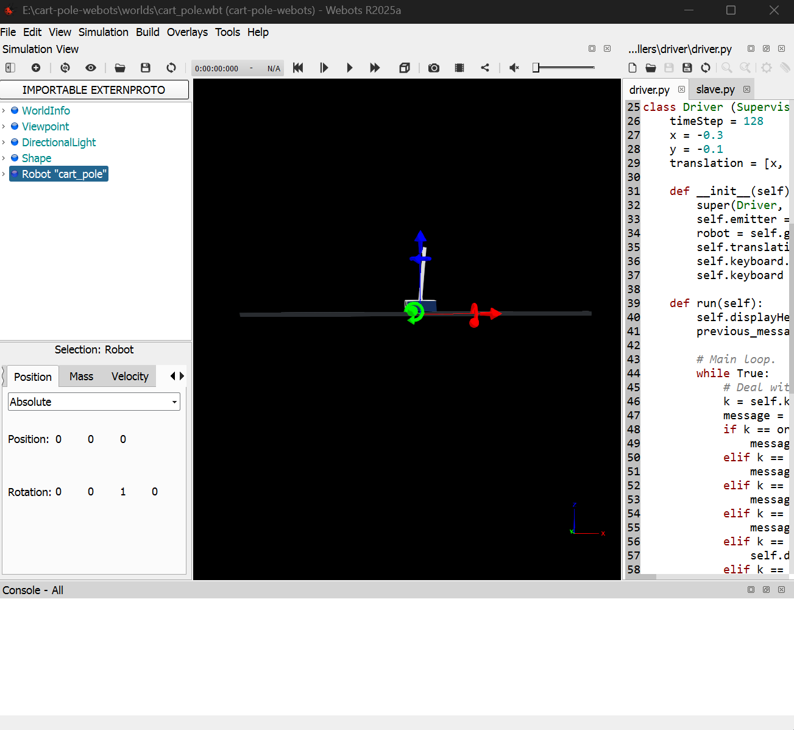

# Webots Cart-Pole

Webots R2025a 的一阶倒立摆（cart-pole）仿真项目。

已完成从被动模型到闭环站立的验证链：

- A1：被动 cart-pole，小车只沿 X 移动，摆杆自由倒下。
- A2：Python 读取 `x`、`θ`，并验证 `±2 N` 施力方向。
- A3：非线性动力学、A2 开环对照、直立点线性化。
- A4：级联 PD-PID 站立 10 s。

当前 `worlds/cart_pole.wbt` 使用 A4 控制器：

```text
controller "cart_pole_pid"
```

## 当前状态

- A0 环境验收：通过（Webots R2025a，Python 3.14.7 64-bit）
- A1 被动模型：通过
- A2 传感器与施力方向：通过
- A3 动力学模型与开环校验：完成
- A4 级联 PD-PID 站立：通过
- A5 LQR 与 PID 对比：待开始

## 模型参数

| 符号 | 含义 | 值 |
|---|---|---:|
| `M` | 小车质量 | `1.00 kg` |
| `m` | 摆杆质量 | `0.24 kg` |
| `L` | 摆杆长度 | `0.50 m` |
| `l` | 铰点到摆杆质心距离 | `0.25 m` |
| `J_y` | 摆杆绕质心、平行于铰轴的转动惯量 | `0.00501 kg·m²` |
| `I_p` | 摆杆绕铰点转动惯量 | `0.0200125 kg·m²` |
| — | 小车行程 | `-1.50 ～ +1.50 m` |
| `θ₀` | 摆杆初始倾角 | `+0.08 rad` |
| — | 仿真步长 | `8 ms` |

## 坐标与符号约定

- 世界坐标系：`ENU`，`+X` 向右，`+Y` 为铰轴方向，`+Z` 向上。
- 直立为 `θ = 0 rad`；杆顶向 `+X` 倾斜为正。
- 控制输入定义为小车沿 `+X` 的力 `F`，单位 `N`。
- `cart_position` 单位为米；`pole_angle` 单位为弧度。

## 文件结构

```text
cart-pole-webots/
  worlds/cart_pole.wbt                  # 当前 A4 世界
  controllers/
    cart_pole_pid/cart_pole_pid.py      # A4 级联 PD-PID
    cart_pole_probe/cart_pole_probe.py  # A2 探针（历史）
  docs/
    A1-acceptance.md                    # A1 验收记录
    A2-acceptance.md                    # A2 验收记录
    A4-acceptance.md                    # A4 验收记录
    a1-initial.png
    a1-fall.png
    a1-verification.txt
    a1-probe-run1.csv
    a1-probe-run2.csv
    a2-positive.txt
    a2-negative.txt
    model.md                            # A3 动力学模型与开环校验
    a4-console.txt                      # A4 Console 输出
  a4_pid_balance.csv                    # A4 10 s / 8 ms 数据
  README.md
```

## 运行 A4

1. Webots R2025a → `File → Open World` → `worlds/cart_pole.wbt`。
2. `Pause` → `Reset Simulation`，确认时间为 `0:00:00:000`。
3. 使用 `Real-time` 或 `Fast` 运行。控制器会记录 10 s 数据：
   - 位置外环 PD 产生 `θ_ref`；
   - 角度内环 PID 产生 `F`；
   - 力限幅 `±10 N`，积分限幅 `±0.25 rad·s`。
4. Console 出现 `A4` 行后 `Pause`；项目根目录生成 `a4_pid_balance.csv`。

## A4 结果

```text
START theta=+0.0802 rad F=+3.742 N
A4 peak_x=0.0934 m tail_x=0.0004 m tail_theta=0.0002 rad
```

| 检查项 | 通过标准 | 实测 |
|---|---|---|
| 初始角度 | 接近 `+0.08 rad` | `+0.08018 rad` |
| 首拍力 | `F > 0 N` | `+3.742 N` |
| 时长 | 10 s | 10.000 s，1251 行 |
| 摆杆 | 不碰 `±1.4 rad` 限位 | 最大 `|θ| = 0.08018 rad` |
| 小车峰值 | `peak_x ≤ 0.30 m` | `0.09343 m` |
| 最后 2 s 小车 | `tail_x ≤ 0.05 m` | `0.00044 m` |
| 最后 2 s 摆角 | `tail_theta ≤ 0.02 rad` | `0.00023 rad` |
| 力饱和 | 不持续饱和 | 最大 `3.742 N < 10 N` |

完整记录见 [docs/A4-acceptance.md](docs/A4-acceptance.md)。

## A3 动力学模型

非线性模型：

```text
(M+m)x¨ + ml cosθ θ¨ - ml sinθ θdot² = F
Ip θ¨ + ml cosθ x¨ = mgl sinθ
```

A2 开环对照：

| 脉冲 | Webots dx | 模型 dx | Webots 末端 θ | 模型末端 θ |
|---|---:|---:|---:|---:|
| `+2.00 N` | `+0.02350 m` | `+0.02237 m` | `+0.04243 rad` | `+0.04443 rad` |
| `-2.00 N` | `-0.02767 m` | `-0.02635 m` | `+0.20537 rad` | `+0.19913 rad` |

最大绝对误差：位移 `0.00132 m`，末端摆角 `0.00624 rad`。

直立点线性化：

```text
A = [0  1   0       0;
     0  0  -1.6646  0;
     0  0   0       1;
     0  0  34.4024  0]
B = [0; 0.9433; 0; -2.8281]
```

开环正特征值约 `5.87 s⁻¹`。完整推导见 [docs/model.md](docs/model.md)。

## A2 验收结果（历史记录）

```text
START F=+2.00 N x=-0.00001 m theta=+0.08018 rad
END pulse=160 ms dx=+0.02350 m theta=+0.04243 rad

START F=-2.00 N x=-0.00001 m theta=+0.08018 rad
END pulse=160 ms dx=-0.02767 m theta=+0.20537 rad
```

`+2 N` 使 `dx > 0`，`-2 N` 使 `dx < 0`；详细记录见 [docs/A2-acceptance.md](docs/A2-acceptance.md)。

## A1 验收结果（历史记录）

A1 使用 `controller "<none>"` 的被动世界：

| 检查项 | 实测结果 |
|---|---|
| 初始摆杆角度 | `+0.080175 rad`（约 `+4.59°`） |
| 2 s 时摆杆角度 | `+1.400000 rad`，绕 `(0, 1, 0)` 轴 |
| 首次到达 `+1.4 rad` 限位 | `0.624 s` |
| 小车 X | `0 → -0.043815 m`（向 `-X` 退约 `4.4 cm`） |
| 小车 Y | 全程 `0.000000 m` |
| 小车 Z | `0.079991 ～ 0.079999 m` |
| 重置可复现 | 两次独立运行 CSV 字节完全一致 |




详细记录见 [docs/A1-acceptance.md](docs/A1-acceptance.md)。

## 备注

- A1/A2 的被动世界和探针控制器保留为历史验证；当前世界已切换为 A4 闭环控制器。
- 该世界没有 `Background` 和地板，3D 背景为黑色是正常的；验收看轨道、小车和摆杆是否可见。
- 原始 `Viewpoint` 已修正；A1 的模型参数未改动。
- A4 的最大力 `3.742 N` 未达到 `±10 N` 限幅，不是靠饱和硬撑。

## 下一步：A5

做 LQR 与级联 PID 的对比：同一初始姿态、同一 Webots 模型，比较站立恢复、位置阶跃和扰动响应。
