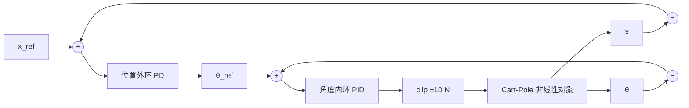
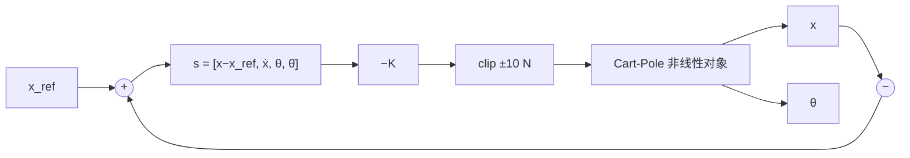

# 开发文档：Webots Cart-Pole

## 1. 系统概述

本项目在 Webots R2025a 中建立一阶倒立摆（cart-pole）模型，并完成从被动开环、传感器/施力方向校验、动力学建模，到级联 PD-PID 与离散 LQR 闭环控制的完整验证链。

- 小车质量 `M = 1.00 kg`
- 摆杆质量 `m = 0.24 kg`（质量摄动组 `0.30 kg`）
- 摆杆长度 `L = 0.50 m`，铰点到质心 `l = 0.25 m`
- 摆杆绕铰点惯量 `I_p = 0.0200125 kg·m²`
- 世界坐标 `ENU`：`+X` 向右，`+Y` 为铰轴，`+Z` 向上
- 直立 `θ = 0`；杆顶向 `+X` 倾斜时 `θ > 0`
- 控制力 `F` 沿 `+X`，限幅 `±10 N`
- 仿真步长 `8 ms`，初始角 `+0.08 rad`

## 2. 控制框图

### 2.1 级联 PD-PID



```text
x_ref ──►(+)──► e_x ──► 位置外环 PD ──► θ_ref ──►(+)──► e_θ ──► 角度内环 PID ──► F ──► clip(±10 N) ──► Cart-Pole
          ▲ -x                                      ▲ -θ                                                   │
          └─────────────────────────────────────────┴──────────────────── x, θ ◄──────────────────────────┘
```

- 外环：`θ_ref = clip(-0.0868·(x - x_ref) - 0.1403·\dot x, ±0.15)`
- 内环：`e = θ - θ_ref`
- `F = clip(46.66·e + 8.23·\dot θ + 1.0·∫e dt, ±10 N)`
- 积分限幅：`±0.25 rad·s`

### 2.2 离散 LQR



```text
x_ref ──► e_x = x - x_ref ──┐
                            ├──► s = [e_x, \dot x, θ, \dot θ] ──► -K ──► F ──► clip(±10 N) ──► Cart-Pole
x, θ ──► 状态估计 ──────────┘                                                              │
      ▲                                                                                     │
      └─────────────────────────────────────────────────────────────────────────────────────┘
```

- `Q = diag(25, 1, 120, 2)`，`R = 1`
- `K = [-4.6918, -5.3978, -41.7045, -7.2396]`
- `F = clip(-K·s, ±10 N)`
- 连续模型按 `8 ms` 零阶保持离散化

### 2.3 被控对象

```text
(M+m)x¨ + ml cosθ·θ¨ - ml sinθ·θdot² = F
I_p θ¨ + ml cosθ·x¨ = mgl sinθ
```

直立点线性化：

```text
A = [0  1   0       0;
     0  0  -1.6646  0;
     0  0   0       1;
     0  0  34.4024  0]
B = [0; 0.9433; 0; -2.8281]
```

开环正特征值约 `5.87 s⁻¹`，直立点不稳定。

## 3. 复现步骤

### 3.1 环境

- Windows 11 64-bit
- Webots R2025a，安装在 `D:\Webots`
- Python 3.14.7 64-bit，解释器 `E:\python.exe`
- 项目目录 `E:\cart-pole-webots`

### 3.2 基础运行

1. 打开 Webots R2025a。
2. `File → Open World`，选择 `worlds/cart_pole.wbt`。
3. 先 `Pause`，再 `Reset Simulation`，确认时间为 `0:00:00:000`。
4. 使用 `Real-time` 或 `Fast` 运行；控制器会在 10 s 后打印 `A6` 汇总行。
5. 查看 Console 和项目根目录的 `a6_{mode}_{case}.csv`。

### 3.3 A6 六组工况

| 工况 | 世界 | `controller` | `controllerArgs` | 输入 |
|---|---|---|---|---|
| PID 位置阶跃 | `cart_pole.wbt` | `cart_pole_pid` | `[ "step" ]` | t=2 s，`x_ref: 0 → +0.20 m` |
| LQR 位置阶跃 | `cart_pole.wbt` | `cart_pole_lqr` | `[ "step" ]` | t=2 s，`x_ref: 0 → +0.20 m` |
| PID 力脉冲 | `cart_pole.wbt` | `cart_pole_pid` | `[ "pulse" ]` | t=4 s 起 `+3 N`，80 ms |
| LQR 力脉冲 | `cart_pole.wbt` | `cart_pole_lqr` | `[ "pulse" ]` | t=4 s 起 `+3 N`，80 ms |
| PID 质量摄动 | `cart_pole_mass.wbt` | `cart_pole_pid` | `[ "mass" ]` | 摆杆 `0.30 kg`，t=2 s 阶跃 |
| LQR 质量摄动 | `cart_pole_mass.wbt` | `cart_pole_lqr` | `[ "mass" ]` | 摆杆 `0.30 kg`，t=2 s 阶跃 |

每次运行前从磁盘重新加载世界；两组控制器使用同一组固定增益，不重新整定。

### 3.4 CSV 字段

```text
t_s, x_ref_m, x_m, theta_rad, disturbance_N, force_N
```

每份 CSV 为 1251 行，覆盖 `0.000 ～ 10.000 s`；`pulse` 组恰好 10 个连续样本 `disturbance_N = 3.0`。

## 4. 实验结论

### 4.1 站立

| 指标 | A4 PD-PID | A5 LQR |
|---|---:|---:|
| 首拍力 | `+3.742 N` | `+3.344 N` |
| `peak_x` | `0.0934 m` | `0.0985 m` |
| `tail_x` | `0.0004 m` | `0.0022 m` |
| `tail_theta` | `0.0002 rad` | `0.0003 rad` |

两种控制器都通过 10 s 站立验收，最大力均未达到 `±10 N` 限幅。

### 4.2 六组对比

| 工况 | 控制器 | `tail_x` (m) | `tail_theta` (rad) | 结果 |
|---|---|---:|---:|---|
| `step` | PID | `0.005933` | `0.000280` | 通过 |
| `step` | LQR | `0.002826` | `0.000334` | 通过 |
| `pulse` | PID | `0.005566` | `0.000532` | 通过 |
| `pulse` | LQR | `0.001193` | `0.000173` | 通过 |
| `mass` | PID | `0.006208` | `0.000308` | 通过 |
| `mass` | LQR | `0.002435` | `0.000292` | 通过 |

主要结论：

- 三个已测工况中，LQR 的末段位置误差都小于 PID。
- 标称位置阶跃下，LQR 超出 `0.20 m` 目标约 `0.0058 m`（2.9%）；PID 在 10 s 记录内未越过目标。
- 摆杆增重 25% 后，两种控制器使用原增益仍通过验收；这说明在该质量变化点仍能工作，但鲁棒范围还需要更多质量点才能界定。
- `pulse` 组的 `peak_x` 包含开场扶正，不能直接当作 `t=4 s` 后扰动峰值；事件后的调节时间需要用 CSV 单独计算。
- 最终算法选型还需把调节时间、超调和力峰值一起纳入比较。

## 演示视频

[观看 demo.mp4](demo.mp4)

- 内容：标题页 → LQR `step` 工况 10 s 站立/位置阶跃片段 → A6 结果页
- 规格：1280×720，25 fps，H.264，约 14.3 s
- 录制：Webots `Make Movie`，3D 视图原生录制，后期加标题页和结果页

## 5. 仓库与版本

- 仓库：https://github.com/lISJ323173/webots-
- 关键提交：
  - `8aa4362 feat(sim): add passive cart-pole world`
  - `8f1a9bb test(sim): verify cart-pole sensors and force direction`
  - `8c36f13 docs(sim): derive and validate cart-pole dynamics`
  - `3869169 feat(sim): stabilize cart-pole with cascaded PD-PID`
  - `7da9b03 feat(sim): add discrete LQR cart-pole controller`
  - `48c6eff test(sim): compare PID and LQR across step, pulse, and mass cases`
- 两套控制代码：
  - `controllers/cart_pole_pid/cart_pole_pid.py`
  - `controllers/cart_pole_lqr/cart_pole_lqr.py`
- 世界文件：
  - `worlds/cart_pole.wbt`
  - `worlds/cart_pole_mass.wbt`

## 6. 已知限制

- 模型忽略摩擦、关节阻尼和限位接触；线性模型只在直立点附近有效。
- 摆杆到达 `±1.4 rad` 硬限位后，简化模型不再适用。
- 质量鲁棒性只测了 `0.30 kg` 一个点，不能据此给出完整鲁棒范围。
- 3D 世界没有 `Background` 和地板，背景为黑色；不影响物理和验收。
